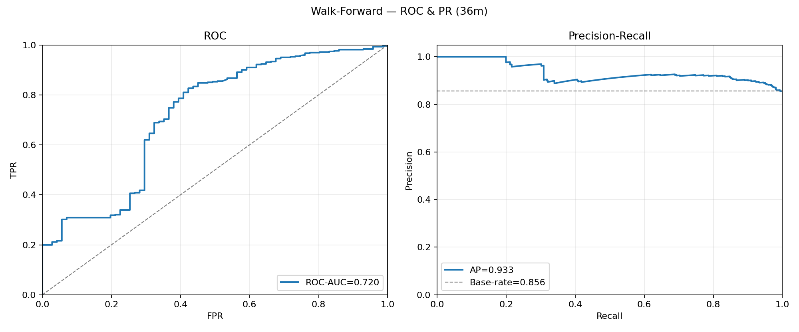
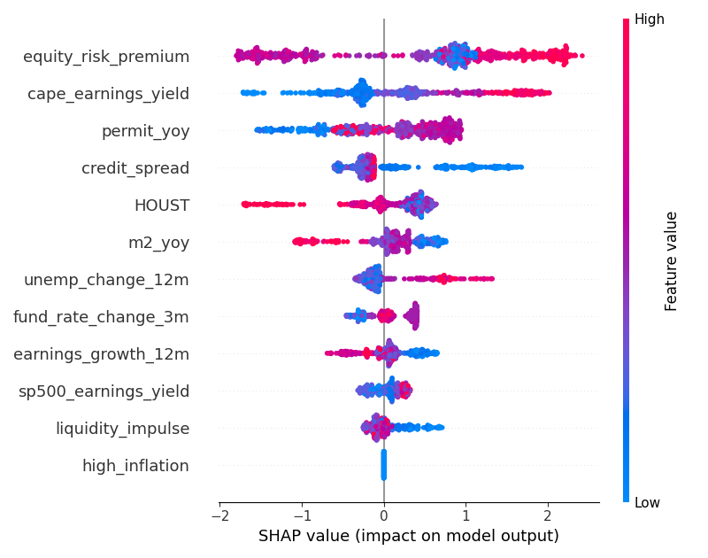
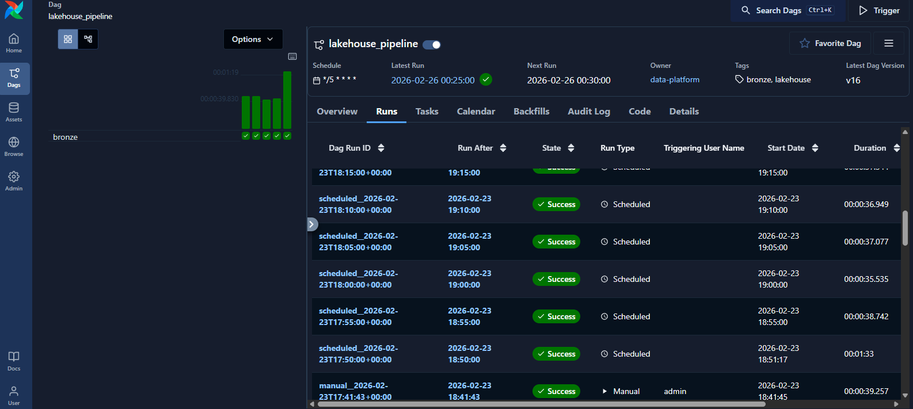
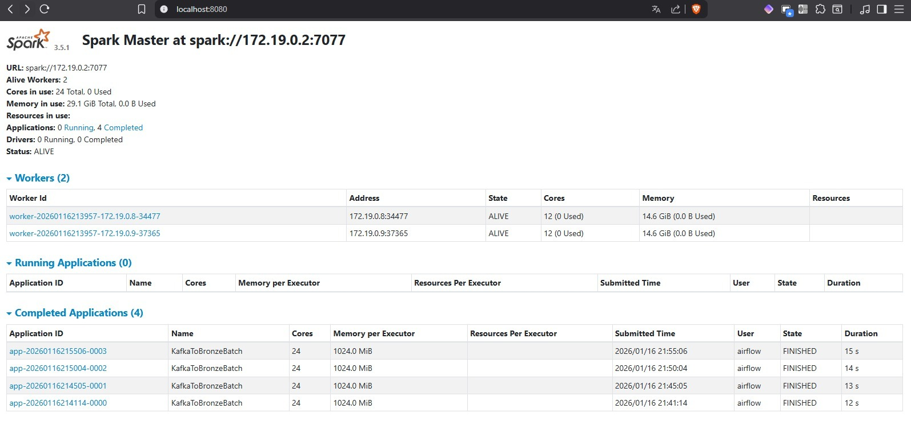
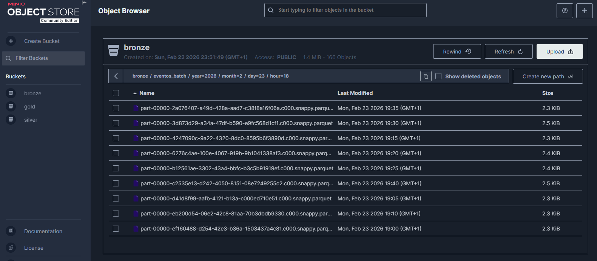

# Selected project figures

These figures were extracted from the embedded raster images in the accompanying thesis, *Diseño de un pipeline automatizado para el despliegue de modelos de machine learning aplicados a la predicción de riesgo financiero* (`TFG.pdf`). Original pixel dimensions, plot labels, and screenshot contents are preserved. The PDF itself is not included in this repository.

The images document the thesis experiments and prototype. They were not regenerated from the current code or datasets. A new pipeline run may produce different features, dates, metrics, or filenames. Plot labels retain their original language.

The source ledger in [sources.json](sources.json) records the source PDF fingerprint, figure identifiers, page numbers, image dimensions, and image fingerprints. **PDF page** counts from the first page of the file; **printed page** is the page number shown in the thesis.

| Figure | Image | PDF page | Printed page | Original dimensions | Download |
| --- | --- | ---: | ---: | --- | --- |
| 5.6 | ROC and precision-recall curves | 79 | 50 | 2000 × 832 | [Raw PNG](walk_forward_roc_pr.png?raw=1) |
| 5.11 | Global SHAP beeswarm | 83 | 54 | 800 × 630 | [Raw PNG](shap_summary_cls.png?raw=1) |
| 3.1 | Airflow DAG run history | 55 | 26 | 1586 × 711 | [Raw PNG](airflow_runs.png?raw=1) |
| 3.4 | Spark cluster status | 64 | 35 | 1595 × 740 | [Raw JPEG](spark_cluster.jpg?raw=1) |
| 3.5 | MinIO Bronze objects | 65 | 36 | 1581 × 693 | [Raw PNG](minio_bronze.png?raw=1) |

Repository-relative image links render directly on GitHub and work in local clones. The download links request the raw image file using `?raw=1`. Curated documentation images are tracked here because generated `models/metrics/` and `models/backtest/` outputs are ignored by Git.

## Temporal model evaluation



Figure 5.6 demonstrates classification evaluation against reference baselines in a time-aware validation setup. It pools predictions from the walk-forward evaluation; its aggregate scores differ from the mean scores across temporal folds. The positive-class base rate is shown in the precision-recall panel.

## Model explainability



Figure 5.11 shows feature attribution in the thesis model. SHAP values explain the model output; they do not establish causal effects or independently validate forecast accuracy.

## Workflow orchestration



Figure 3.1 shows scheduled pipeline runs and recorded execution outcomes in Airflow, making the ingestion workflow inspectable.

## Distributed batch processing



Figure 3.4 shows two live Spark workers and completed Kafka-to-Bronze batch applications, documenting execution on the prototype cluster.

## Partitioned object storage



Figure 3.5 shows Snappy-compressed Parquet objects under year, month, day, and hour partitions in the MinIO Bronze bucket. The infrastructure screenshots document the thesis prototype; see the main README for the current PoC scope.

## Regenerating research outputs

Use the existing stage commands from the repository root to generate fresh outputs under `models/metrics/`:

```bash
python models/run_pipeline.py --stage eda
python models/run_pipeline.py --stage walk-forward
python models/run_pipeline.py --stage rollout
python models/run_pipeline.py --stage explain
```

Fresh outputs do not overwrite this curated gallery. If replacing a thesis image with a new run, update its caption and source ledger to distinguish the new run from the original experiment.
