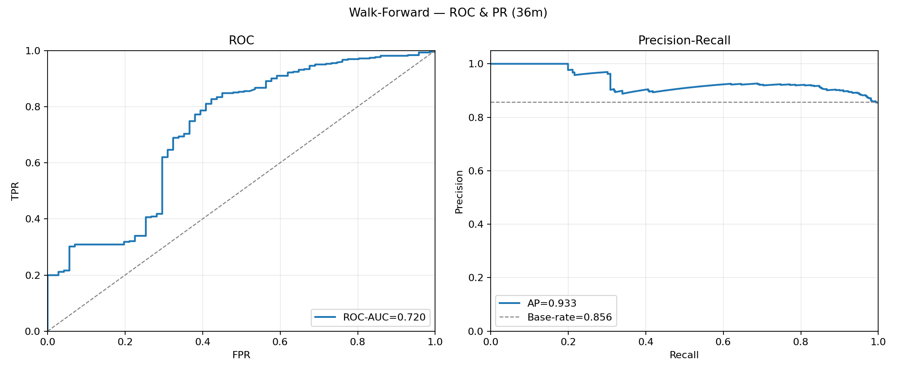
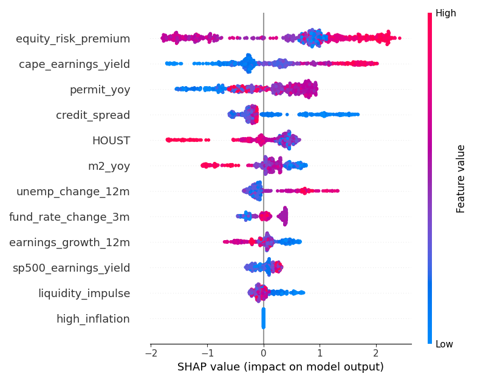
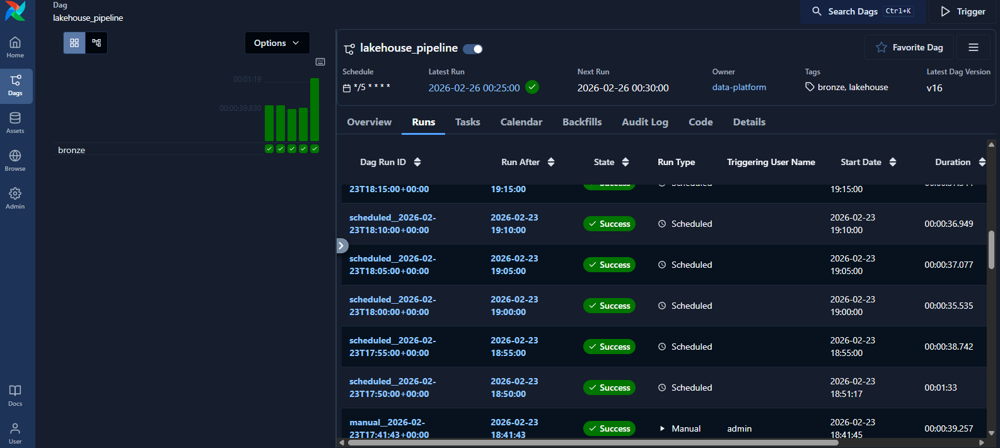
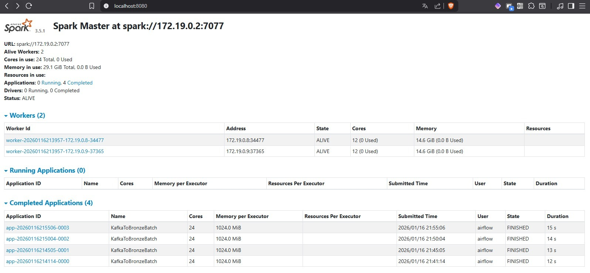
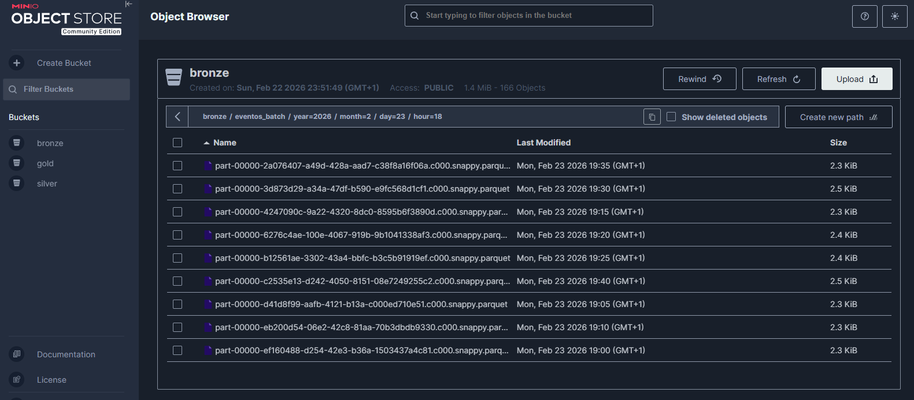

# Selected project figures

This gallery contains four figures from the selected MLflow setup and five original thesis images. Original pixel dimensions and plot labels are preserved. The source ledger in [sources.json](sources.json) keeps the MLflow run metadata and image fingerprints under `mlflow_runs`, separately from the thesis source references under `figures`.

## Selected MLflow setup: `shallow-weight1-f1_1`

The four PNGs below were copied from the persistent artifacts of experiment `class-zero-policies-h36` (ID `4`), run `b33cfa49d6a54d2e9bc40d3900897558`. They show 492 out-of-sample monthly predictions from January 1982 through December 2022, across 41 annual walk-forward folds at a 36-month horizon. The input uses the five default features and complete-case history from 1962. The model uses depth-2 trees, equal class weights and thresholds selected by validation F1 for class 1.

The classification diagnostics were reconstructed from the run's saved out-of-sample predictions and logged back to the same run. The investment figure uses the saved class predictions and recorded closing prices, including the updated DCA line styling. Exporting these documentation copies did not retrain the model or change its predictions.

| Image | Source artifact within the run | Dimensions | Download |
| --- | --- | --- | --- |
| Class 0 ROC and precision-recall | `diagnostics/walk_forward_roc_pr_class0.png` | 2000 × 832 | [Raw PNG](shallow_weight1_f1_1/roc_pr_class0.png?raw=1) |
| Predictions and probabilities over time | `diagnostics/walk_forward_classification.png` | 2240 × 1120 | [Raw PNG](shallow_weight1_f1_1/classification.png?raw=1) |
| Confusion matrix | `diagnostics/walk_forward_confusion_matrix_heatmap.png` | 1280 × 1080 | [Raw PNG](shallow_weight1_f1_1/confusion_matrix.png?raw=1) |
| Investment strategy ROI | `investment/investment_strategies.png` | 2240 × 800 | [Raw PNG](shallow_weight1_f1_1/investment_strategies.png?raw=1) |

The [main README](../../README.md#selected-setup-shallow-weight1-f1_1) presents these figures alongside their interpretation. Pooled class 0 results are AP₀ 0.307, recall₀ 45.1% (32 of 71 negatives), precision₀ 48.5%, and 34 false alarms for class 0 (actual 1, predicted 0). The negative-class prevalence is 14.4%. In the confusion matrix, TN/FP/FN/TP use class 1 as the positive label.

The signal ROI is 622.2%, DCA 596.3% and modified value averaging 598.3%. Their cumulative contributions differ: 852, 492 and 492.36 units respectively for a monthly base amount of 1. These are returns relative to each strategy's own contributions, not an equal-budget comparison. Fees, dividends and cash interest are excluded. Monthly 36-month labels overlap, so the 492 evaluated months are not independent observations.

## Original thesis figures

The five images below were extracted from embedded raster images in the accompanying thesis, *Diseño de un pipeline automatizado para el despliegue de modelos de machine learning aplicados a la predicción de riesgo financiero* (`TFG.pdf`). The PDF itself is not included in this repository.

They document the thesis experiments and prototype and were not regenerated from the current code or datasets. In particular, the SHAP figure explains the thesis model, not the selected MLflow run. A new pipeline run may produce different features, dates, metrics, or filenames. Plot labels retain their original language.

The thesis ledger records the source PDF fingerprint, figure identifiers, page numbers, image dimensions, and image fingerprints. **PDF page** counts from the first page of the file; **printed page** is the page number shown in the thesis.

| Figure | Image | PDF page | Printed page | Original dimensions | Download |
| --- | --- | ---: | ---: | --- | --- |
| 5.6 | ROC and precision-recall curves | 79 | 50 | 2000 × 832 | [Raw PNG](walk_forward_roc_pr.png?raw=1) |
| 5.11 | Global SHAP beeswarm | 83 | 54 | 800 × 630 | [Raw PNG](shap_summary_cls.png?raw=1) |
| 3.1 | Airflow DAG run history | 55 | 26 | 1586 × 711 | [Raw PNG](airflow_runs.png?raw=1) |
| 3.4 | Spark cluster status | 64 | 35 | 1595 × 740 | [Raw JPEG](spark_cluster.jpg?raw=1) |
| 3.5 | MinIO Bronze objects | 65 | 36 | 1581 × 693 | [Raw PNG](minio_bronze.png?raw=1) |

Repository-relative image links render directly on GitHub and work in local clones. The download links request the raw image file using `?raw=1`. Curated documentation images are tracked here because generated `models/metrics/` and `models/backtest/` outputs are ignored by Git.

## Temporal model evaluation



Figure 5.6 demonstrates classification evaluation against reference baselines in a time-aware validation setup. It pools predictions from the walk-forward evaluation; its aggregate scores differ from the mean scores across temporal folds. The positive-class base rate is shown in the precision-recall panel.

## Model explainability



Figure 5.11 shows feature attribution in the thesis model. SHAP values explain the model output; they do not establish causal effects or independently validate forecast accuracy.

## Workflow orchestration



Figure 3.1 shows scheduled pipeline runs and recorded execution outcomes in Airflow, making the ingestion workflow inspectable.

## Distributed batch processing



Figure 3.4 shows two live Spark workers and completed Kafka-to-Bronze batch applications, documenting execution on the prototype cluster.

## Partitioned object storage



Figure 3.5 shows Snappy-compressed Parquet objects under year, month, day, and hour partitions in the MinIO Bronze bucket. The infrastructure screenshots document the thesis prototype; see the main README for the current PoC scope.

## Regenerating research outputs

Use the existing stage commands from the repository root to generate fresh outputs under `models/metrics/`:

```bash
python models/run_pipeline.py --stage eda
python models/run_pipeline.py --stage walk-forward
python models/run_pipeline.py --stage rollout
python models/run_pipeline.py --stage explain
```

Fresh outputs do not overwrite this curated gallery. If replacing a thesis image with a new run, update its caption and source ledger to distinguish the new run from the original experiment.
